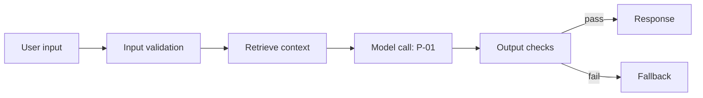

# AI system design: <AI / LLM feature>

<!--
Rules for this document:
- Describes how the AI part works: models, prompts, tools, data flow and guardrails.
  What it must achieve lives in the PRD; how quality is measured lives in docs/evals/plan.md.
- Choose the simplest architecture that meets the requirements: single call → workflow → agent.
  Justify anything more complex.
- Model choices are ADRs. Cost and latency budgets are eval criteria (EV-) in the eval plan.
- IDs: prompts P-01…, tools T-01…. Never renumber.
- Prompts live in the repository as files, versioned like code — not inline strings scattered in code.
- Target length: 1–2 pages.
-->

## Task and scope

- Feature: <what the AI does for the user> — PRD: US-…, FR-…
- Architecture: <single call | workflow (fixed steps) | agent (model chooses steps) | multi-agent | RAG>
- Why this architecture: <reason; why a simpler one isn't enough>
- Not handled by AI: <parts deliberately done with plain code>

## Model and data flow

## Models

| Role | Model | Provider | Why | Fallback | ADR |
|---|---|---|---|---|---|
| <main generation> | <model id> | <provider> | <quality / cost / latency> | <model or degraded mode> | ADR-NNNN |
| <judge / classifier> | <…> | <…> | <…> | <…> | <…> |

## Prompts

| ID | Purpose | File | Inputs | Output format |
|---|---|---|---|---|
| P-01 | <e.g. answer question from sources> | `prompts/<name>.md` | <variables> | <text / JSON schema link> |

## Tools

<!-- Only for agents and tool-using workflows. Delete otherwise. -->

| ID | Tool | What it does | Side effects | Needs confirmation |
|---|---|---|---|---|
| T-01 | <search_orders> | <…> | read-only | no |
| T-02 | <cancel_order> | <…> | writes | yes |

## Context and retrieval

<!-- Delete if there is no retrieval. -->

- Sources: <documents, DB tables, APIs>
- Indexing: <chunking, embedding model, vector store>
- Freshness: <how and when the index is updated>
- Context budget: <max tokens of retrieved context per call>

## Guardrails

| Risk | Control |
|---|---|
| Prompt injection (user input or retrieved content) | <e.g. untrusted content delimited, tools need confirmation> |
| Unsafe or off-topic output | <e.g. output classifier, refusal message> |
| Invalid structured output | <schema validation + one retry> |
| Leaking personal data | <redaction before the call> |

## Data sent to model providers

<!-- Summary only. Requirements are PRD NFRs; the provider choice is an ADR. -->

| Data | Sent to | Contains PII | Retention at provider | NFR |
|---|---|---|---|---|
| <user question> | <provider> | <yes / no> | <e.g. zero retention> | NFR-… |

## Failure handling

- Timeouts: <per call>
- Retries: <policy, which errors>
- Rate limits: <handling>
- Degraded mode: <what the user sees when the model is unavailable>

## Budgets

- Cost and latency targets: see eval plan EV-… (cost per request, p95 latency)

## Open questions

- [NEEDS CLARIFICATION: <question>]
