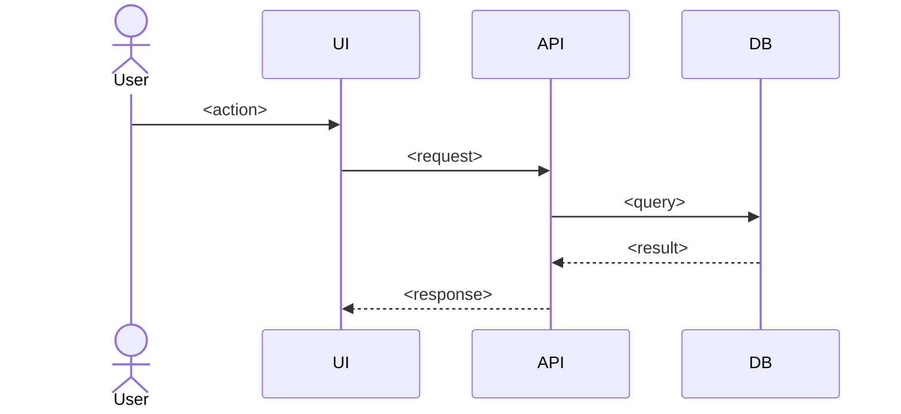

# Architecture overview: <Product name>

<!--
Rules for this document:
- A short entry point (max 2 pages) that ties the architecture together and links to the detail.
  It does not repeat it: diagrams live in the Structurizr workspace, data in the ERD, decisions in ADRs.
- Structure is a lightweight version of arc42.
- Update it when an ADR changes something listed here.
-->

## Quality goals

<!-- The top 3–5 qualities the architecture optimises for, in priority order. Link NFRs. -->

| Priority | Quality | Scenario | NFR |
|---|---|---|---|
| 1 | <e.g. performance> | <e.g. landing page LCP < 2.5 s on 4G> | NFR-001 |
| 2 | <e.g. security> | <…> | NFR-002 |

## Constraints

- <e.g. must run on Vercel; budget; team size; legal / data residency>

## Stack

| Layer | Choice | Version | ADR |
|---|---|---|---|
| Frontend | <e.g. TanStack Start> | <x.y.z> | ADR-0002 |
| Backend | <…> | <…> | ADR-0003 |
| Database | <…> | <…> | ADR-0004 |
| Hosting / CI | <…> | — | ADR-0005 |

Versions resolved on: YYYY-MM-DD

## System context and containers

- C4 workspace: `docs/architecture/c4/workspace.dsl`
- Context (level 1): <one sentence: the system, its users and external systems>
- Containers (level 2): <one line per container: purpose and technology>

## Routes

<!-- Web projects: the page map. Delete for other project types. Rendering: static (prerendered) | server (on request) | client (SPA). -->

| Route | Page | Rendering | Story |
|---|---|---|---|
| `/` | <page> | static | US-1 |

## Code structure

<!-- How Clean Architecture (or the chosen convention) maps to folders. -->

```
src/
  domain/          # entities, business rules — no framework imports
  application/     # use cases
  infrastructure/  # DB, HTTP, external services (humble objects)
  ui/              # components: atoms / molecules / organisms / templates / pages
```

## Key flows

<!-- One sequence diagram per critical flow. -->



## Data

- ERD: `docs/architecture/erd.md`
- Ownership: <which container owns which data>

## Cross-cutting concerns

| Concern | Approach |
|---|---|
| Authentication / authorisation | <…> |
| Error handling | <…> |
| Logging / observability | <…> |
| Configuration and secrets | <env vars; secret scanning with gitleaks> |
| Testing | <unit: Vitest; E2E: Playwright> |

## Deployment

- Environments: <local / preview per PR / production>
- Pipeline: see `CONTRIBUTING.md`

## Decisions

<!-- Index of ADRs, newest last. -->

| ADR | Title | Status |
|---|---|---|
| 0001 | Record architecture decisions | accepted |
| 0002 | <…> | <…> |

## Risks and technical debt

- <risk or debt> — see backlog `TD-…`
