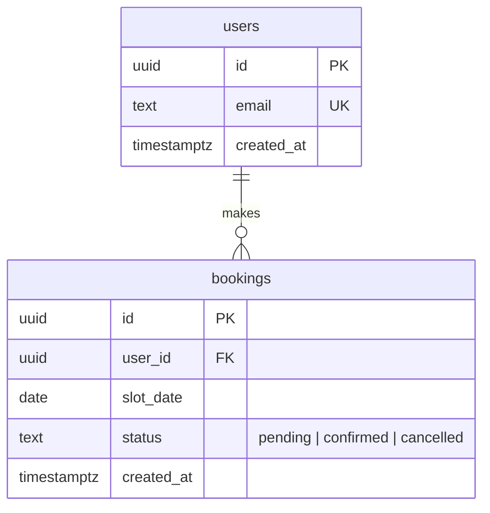

# Data model: <Product name>

<!--
Rules for this document:
- Entity names are the real table names (snake_case, plural). The diagram, schema.sql
  and the migrations must use the same names, so they can be compared mechanically.
- This file explains meaning and rules; exact types, constraints and indexes live in schema.sql.
- Every table links the story or requirement that needs it. No speculative tables.
- Before scaffold, schema.sql is the source of truth. After scaffold, the migrations are;
  update this file and schema.sql when they change.
- Target length: 1–2 pages.
-->

## Entities

| Table | Purpose | Owned by (container) | Needed by |
|---|---|---|---|
| <users> | <one line> | <e.g. Supabase Auth> | US-1 |
| <bookings> | <one line> | <e.g. API> | US-2, FR-004 |

## Diagram

<!-- Show keys and the columns that matter for understanding; schema.sql has the full list. -->

## Business rules

<!-- Invariants the diagram can't show. Say where each one is enforced. -->

| Rule | Enforced by |
|---|---|
| <a slot can't be booked twice> | <unique (slot_date, slot_time) in schema.sql> |
| <a booking can only be cancelled before its date> | <domain layer: CancelBooking use case> |

## Access and privacy

- Personal data: <columns holding PII, why they are needed, retention period>
- Row-level security: <who can read / write each table> — policies in schema.sql
- Deletion: <what happens to a user's data when the account is deleted>

## Open questions

- [NEEDS CLARIFICATION: <question>]
