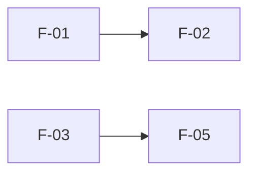

# Feature breakdown: <Product name>

<!--
Rules for this document:
- Built as a story map: user activities (left to right, in journey order) → features → stories.
- IDs: activities A-1…, features F-01…, stories reuse the PRD IDs (US-1…). Never renumber.
- The first slice is the walking skeleton: the thinnest end-to-end version that lets a user
  complete the whole journey. It cuts across every activity — not one activity built fully.
- Keep 5–10 activities. Detail lives in the PRD stories, not here.
-->

## Activities (backbone)

| ID | Activity | User goal |
|---|---|---|
| A-1 | <e.g. Discover> | <what the user is trying to do> |
| A-2 | <e.g. Sign up> | <…> |
| A-3 | <e.g. Core task> | <…> |

## Story map

| Slice | A-1 <activity> | A-2 <activity> | A-3 <activity> |
|---|---|---|---|
| **Now — walking skeleton (MVP)** | F-01 · US-1 | F-03 · US-3 | F-05 · US-5 |
| **Next** | F-02 · US-2 | — | F-06 · US-6 |
| **Later** | — | F-04 · US-4 | F-07 · US-7 |

**Outcome of each slice**
- Now: <what a user can do end to end>
- Next: <…>
- Later: <…>

## Features

| ID | Feature | Activity | Stories | Slice | Depends on | Status |
|---|---|---|---|---|---|---|
| F-01 | <name> | A-1 | US-1 | Now | — | planned |
| F-02 | <name> | A-1 | US-2 | Next | F-01 | planned |

<!-- Status: planned | in progress | done | deferred (→ backlog.md) | dropped -->

## Dependencies

## Open questions

- [NEEDS CLARIFICATION: <question>]
