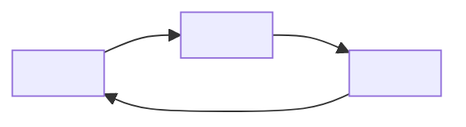
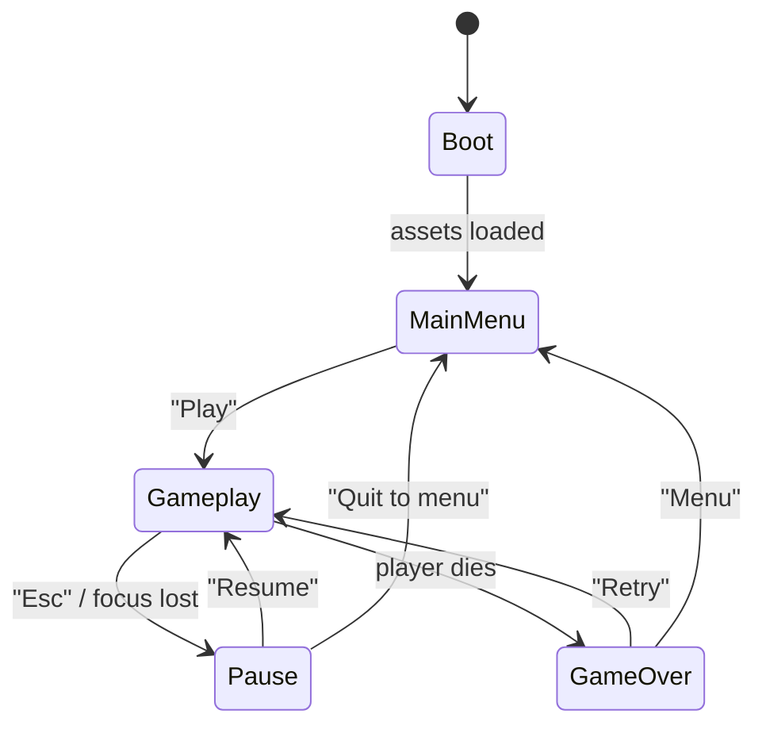

# GDD: <Game title>

<!--
Rules for this document:
- Maximum 2 pages. It holds the vision; the playable prototype is the source of truth for detail.
- Detailed systems get their own one-page design in design/<system>.md.
- Tag every mechanic as hypothesis until a playtest validates it.
- Pillars and the cut list are the guardrails: anything that breaks a pillar or is on the cut list is not built.
-->

## Pitch

<!-- One or two sentences: what the player does and why it's fun. -->

## Target player and platform

- Player: <who, what they already play>
- Platforms: <PC / console / mobile / web>
- Session length: <e.g. 10–20 min>

## Pillars

<!-- 3–5 short statements used to settle design disputes. -->

1. <pillar>
2. <pillar>
3. <pillar>

## Intended player experience

<!-- How the game should feel. Player stories: "As a player I can <x> with <y> in order to feel <z>." -->

## Core loop

## Key mechanics

| Mechanic | Description | Status | Prototype / build |
|---|---|---|---|
| <name> | <one line> | hypothesis | <link> |

## Progression

<!-- How the player advances: levels, unlocks, difficulty curve. -->

## Scenes and states

<!-- Top-level scenes / game states and what moves between them. Each edge names its trigger. -->

## Controls

| Input | Action |
|---|---|
| <key / button / gesture> | <action> |

## Art and audio direction

<!-- Style, references, mood. Link a moodboard instead of describing it at length. -->

## Comparables and differentiation

| Game | What we take | What we do differently |
|---|---|---|
| <title> | <…> | <…> |

## Monetization

<!-- Premium / free-to-play / none. Delete this section if not applicable. -->

## Tech

- Engine: <Godot / Unity / Unreal / Phaser> — see ADR-0002
- Target performance: <e.g. 60 fps on <device>>
- Save data: <none / local / cloud>
- Asset pipeline: `design/asset-pipeline.md`

## Scope and cut list

- **In scope for first playable:** <…>
- **Cut / not doing:** <…>

## Open questions

- [NEEDS CLARIFICATION: <question>]

## Decision log

<!-- Short dated entries for design decisions. Research and playtest notes live elsewhere. -->

| Date | Decision | Reason |
|---|---|---|
| YYYY-MM-DD | <…> | <…> |
