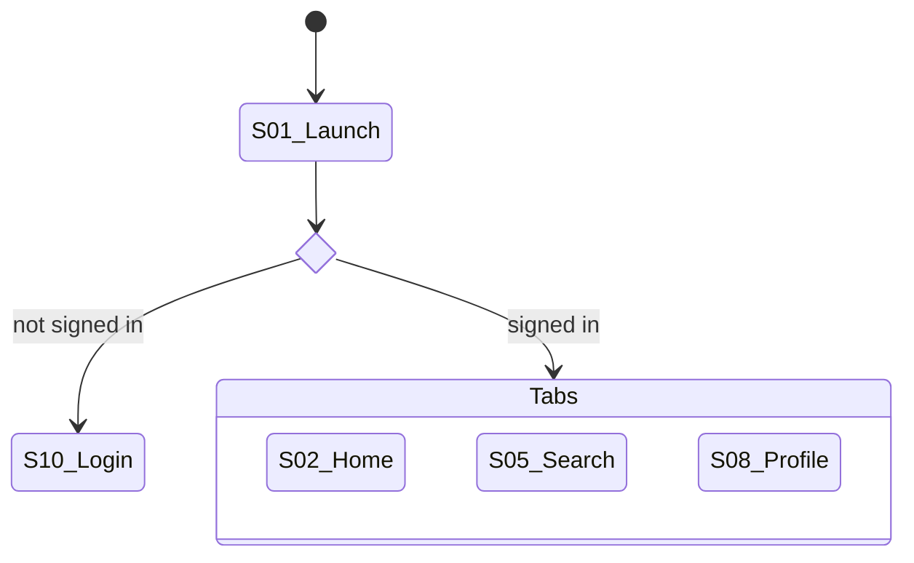
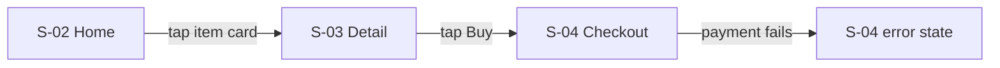

# Screen flow: <App name>

<!--
Rules for this document:
- Every screen has a stable ID (S-01, S-02 …). Use the same ID in the inventory,
  the diagrams and the code (route or component name).
- Every edge in a diagram is labelled with the element that triggers it.
- Every screen lists its non-default states. Empty sections explain why they are empty.
-->

## Navigation model

- Pattern: <tab bar / stack / drawer>
- Tabs (≤ 5, navigation only — no actions): <S-02 Home, S-05 Search, S-08 Profile>
- Each tab keeps its own navigation stack: <yes / no>
- Modals: <which screens open as modals>

## Screen inventory

| ID | Name | Purpose | Entry from | Exits to | Data | Auth | Route / deep link |
|---|---|---|---|---|---|---|---|
| S-01 | Launch | <…> | app start | S-10, S-02 | — | no | — |
| S-02 | Home | <…> | tab | S-03 | <API / entity> | yes | app://home |

## Screen states

| ID | Loading | Empty (reason shown) | Error | Offline | Permission denied |
|---|---|---|---|---|---|
| S-02 | skeleton | "No items yet — <action>" | retry banner | cached data + notice | — |

## Key flows

<!-- One diagram per key flow: onboarding, sign-in, core task, purchase. -->

### Flow: <name>

## Permission prompts

| Permission | Asked on | Why (shown to user) | If denied |
|---|---|---|---|
| <camera / location / notifications> | <screen + trigger> | <reason> | <fallback> |

## Deep links

| Link | Screen | Required state | If not signed in |
|---|---|---|---|
| app://item/{id} | S-03 | item exists | S-10 then back to S-03 |

## Analytics events

<!-- Optional. -->

| Event | Screen | Trigger |
|---|---|---|
| <item_viewed> | S-03 | screen shown |
